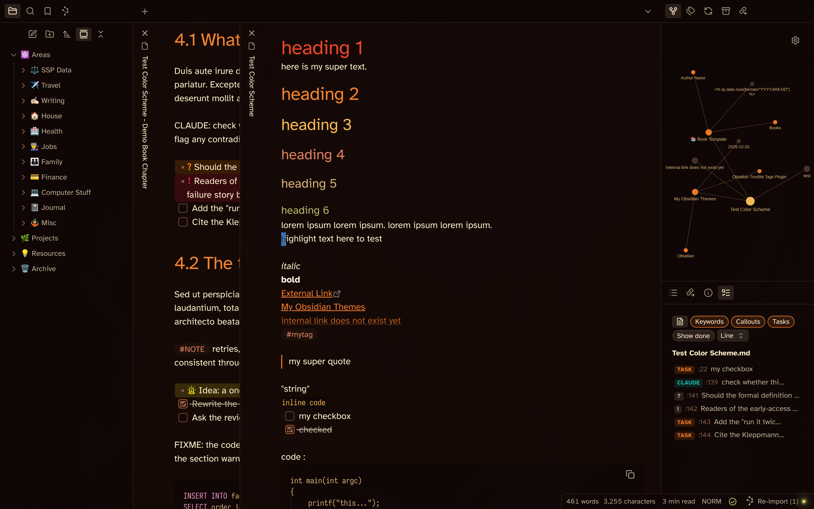
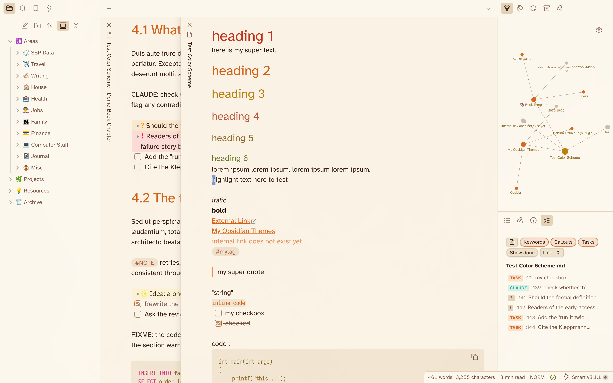
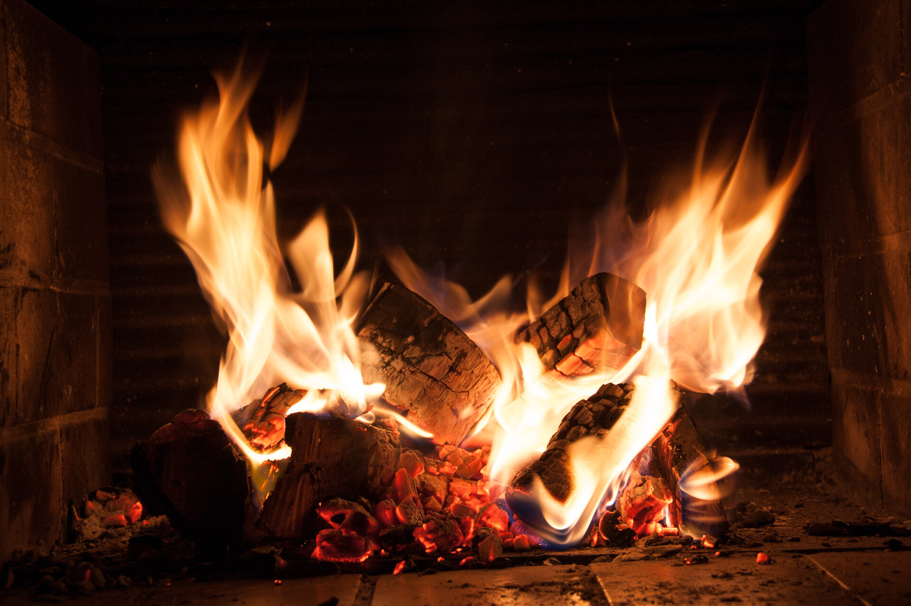
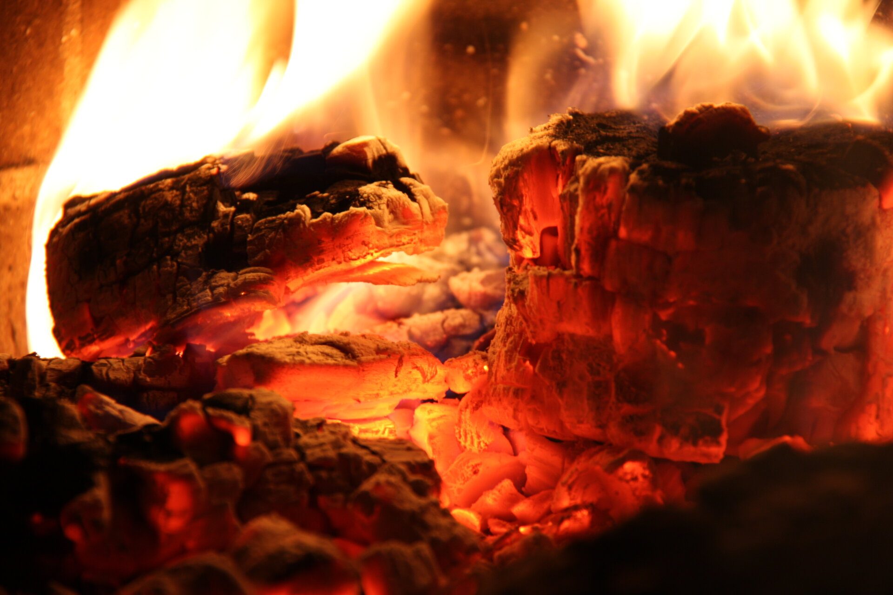

# Fireplace (Obsidian Theme)
This is a **Fireplace** theme for [Obsidian](https://obsidian.md/). The color palette is generated from my own photos of a fireplace and glowing embers and is the same palette I use for my [Omarchy](https://omarchy.org) theme [omarchy-fireplace-theme](https://github.com/sspaeti/omarchy-fireplace-theme). It supports dark and light mode.

Installation: Simply search `Fireplace` in the Obsidian Community Themes and Install. Or if manually, copy the `theme.css` file to `.obsidian/themes/Fireplace/` in your vault directory and reload Obsidian for it to take effect.

## Dark Mode


## Light Mode (Hearth on warm paper)


## Based on these Photos
The dark palette is extracted from these pictures, which I use as desktop backgrounds in Omarchy:

Main shot:

Close-up shot:


### Color Palette

| Role       | Dark      | Light     |
|------------|-----------|-----------|
| Background | `#140806` | `#fbf3e6` |
| Foreground | `#fbedca` | `#3a2218` |
| Accent     | `#f07a2a` | `#d9671c` |
| Red        | `#e8452a` | `#c0341c` |
| Yellow     | `#f7b955` | `#b8810f` |
| Orange     | `#f5842e` | `#d2621a` |
| Green      | `#b9b86a` | `#6f7a2a` |
| Sand       | `#d9b27c` | `#8f6b2a` |
| Copper     | `#d07a4a` | `#a8512a` |
| Salmon     | `#e08060` | `#b95a3e` |

### Bump Version

```sh
npm run version
```

---

*Check also my other Theme I created, [Asia Neon](https://github.com/sspaeti/obsidian_asia_neon/), [Kanagawa](https://github.com/sspaeti/obsidian_kanagawa), [Kanagawa Paper](https://github.com/sspaeti/obsidian_kanagawa_paper/), [Rosé Pine](https://github.com/sspaeti/obsidian_rose_pine/), [Osaka Jade](https://github.com/sspaeti/obsidian_osaka_jade).*
